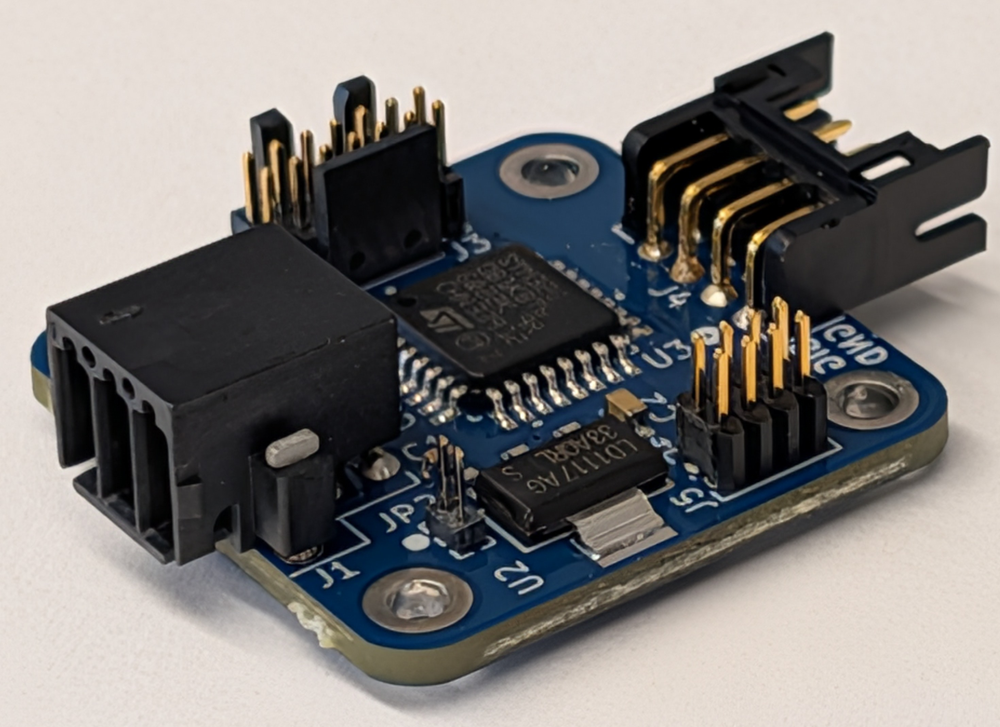

# Overview
This repo contains the firmware to be flashed onto EFI's can\_to\_pwm hardware to respond to DroneCAN protocol which is the current protocol maintained by px4. The libuavcan repo is depracated. In the interest of a reduced software footprint a forked libuavcan repo was used (forked for reduced flash usage). However if a smaller footprint is desired the libcanard repo can be used (https://github.com/dronecan/libcanard.git). 

This repo is written to be compatible with Ether Form Incorporated (EFI)'s  can\_to\_pwm Rev B+. 



This board supports 4 pwm outputs controlled via DroneCAN's  ArrayCommand(1010) or RawComand(1030) for servo and motor commands respectively. Populating pin 1 of J5 (labelled on board) will force the board into servo control mode (unpopulated will imply motor control). The remaining pins 2-4 are used to offset the actuator id. Pin 2 is taken as the LSB and pin 4 as the MSB (For a maximum offset of 8). Therefore to use more than 12 actuators a SW offset must be set (See Building and Flashing). Since the board has 4 pwm outputs it is assumed that actuator id  of output 0 Id\_0 is equal to the pin based id offset. Id\_1 is equal to id offset + 1, Id\_2 is equal to id offset + 2, and Id\_3 is eqaul to id offset + 3.


# Building and Flashing
The software can be built for two different architectures, STM32 and POSIX. The POSIX build can be used to verify, experiment, and test the software/hardware, whereas the STM32 architecture will load onto EFI's HW for CAN based actuation.

## STM
Note that cmake will use the STM architecture by default.

```bash
mkdir build\_stm
cd build\_stm
cmake .. -DARCH=STM
make
```

After connecting an appropriate USB based STM32 flasher (e.g. STLINK-V3MINNIE):

```bash
make flash
```

The SW is now loaded on your HW. 


## Posix (Testing)
```bash
mkdir build\_posix
cd build\_posix
cmake .. -DARCH=POSIX
make
```

# Testing 
The POSIX build type generates 4 binaries which are intended to demo and verify the HW and UAVCAN interface.

In order to communicate with the STM32 from laptop or PC, this repo assumes the use of a UART to CAN converter. This was specifically tested using the below product:


https://www.electromaker.io/shop/product/usb-can-analyzer?srsltid=AfmBOoo8ui31hktLYzUtisjxzqUPLeP86UoOVy075a30c6nakciVkjo-

However, any such converter can be used (If not UART to CAN then a substitute interface must be defined and passed in as a template in place of Usb\_can\_interface.h

1. can\_to\_pwm\_firmware\_test\_CLI
2. can\_to\_pwm\_firmware\_test\_CLI\_RESP
3. can\_to\_pwm\_firmware\_test\_loopback\_test
4. can\_to\_pwm\_firmware\_test\_tests

----

1. A command line application which commands servo or motor commands which the can\_to\_pwm board will receive and respond to.
2. An application which will receive and decode uavcan messages. This can be used to verify the CLI application or receive board hearbeats.
3. This applciation specifically tests the SW interface with HW out of the loop. It will verify that the UAVCAN code as written can be transmitted and received over the selected interface (usbcan in this instance)
4. This is an interface indepdent SW test which will uses custom implemented echo message type to verify that the HW is alive.
